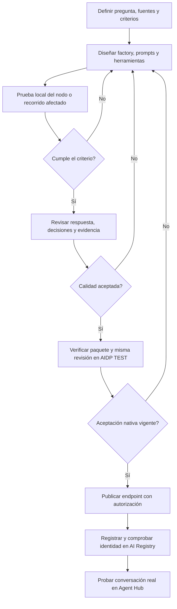

# Flujo de desarrollo de un agente

El plugin combina instrucciones para Codex y un motor CLI. El desarrollador define
el resultado esperado y autoriza las operaciones; Codex implementa y diagnostica;
el motor ejecuta comprobaciones y conserva evidencia. Este es un recorrido de
trabajo supervisado, no una automatización que garantice por sí sola calidad.

[Diagrama interactivo](diagrams/flujo-desarrollo.html) ·
[Fuente editable del diagrama](diagrams/flujo-desarrollo.json) ·
[Tutorial con comandos](guia-de-uso.md)

## Qué se comprueba en cada etapa

| Etapa | Trabajo y evidencia | Condición para avanzar |
| --- | --- | --- |
| Definición | Preguntas representativas, resultados esperados y restricciones reales | Criterios revisados y casos discriminantes |
| Implementación | Factory portable, módulos y adaptadores de modelo/servicios | Contratos coherentes y paquete verificable |
| Prueba local | Fixture, nodo con modelo o recorrido parcial según el fallo | Comprobaciones afectadas aprobadas, sin efectos inciertos por conciliar |
| Calidad | Fuentes, atribución, alcance y hechos omitidos; juez calibrado cuando se utilice | Evaluación trazable; desacuerdos y límites explícitos |
| TEST | Estructura exacta, revisión servida, herramientas e integración nativa | Evidencia vigente del candidato y requisitos declarados |
| Publicación | Endpoint asíncrono y lectura de su estado terminal | Revisión aceptada publicada con autorización |
| Registry | Registro activo de la identidad y versión esperadas | Binding comprobado y acceso disponible |
| Agent Hub | Conversación real del caso de negocio | Respuesta útil y presentación/streaming cuando corresponda |

Si una operación queda pendiente, se consulta y concilia su identidad existente
antes de repetirla. Una respuesta de transporte correcta no sustituye la aceptación
del caso. La mera disponibilidad de un enlace tampoco demuestra acceso al agente.

## Iteración y conservación de resultados

Corregir un prompt exige rastrear su entrada, contrato y consumidor. Un problema
de recuperación o de validación se corrige en esa frontera. Se prueba primero el
fallo aislado, después la integración afectada. Un cambio de código invalida los
recibos cuya identidad deja de coincidir; no obliga a rehacer el proyecto.

Para modificaciones ajenas de criterios del plan, los recibos nuevos por nodo
pueden conservar crédito si coinciden sus dependencias verificadas. Los recibos
históricos se conservan íntegros. La aceptación integrada mantiene su comprobación
del plan completo. No hay una caché general que deduzca equivalencia de cualquier
cambio de código.

Las comparaciones de consistencia usan la misma pregunta, fuentes y revisión
identificada. Sus resultados describen hechos compartidos y omitidos; no fijan un
porcentaje universal que convierta una respuesta en correcta. Calibrar un juez con
un conjunto finito tampoco certifica su precisión general.

## Alcance del diagrama

Las etapas resumen el tutorial y los contratos del motor. El HTML conserva fuentes
vinculadas a una revisión del repositorio; el JSON permite editarlo con Archify.
El diagrama no representa una única orden que implemente, pruebe y publique sin
intervención. La licencia del plugin es [MIT](../LICENSE); los componentes de
terceros conservan sus avisos y licencias propios.
